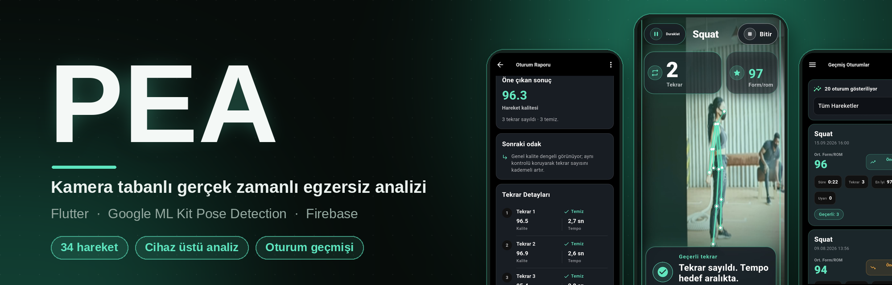
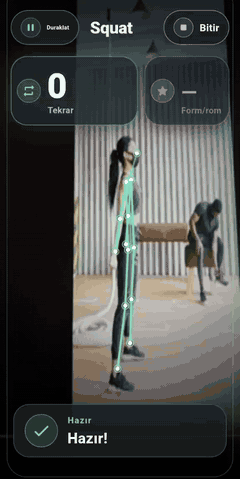
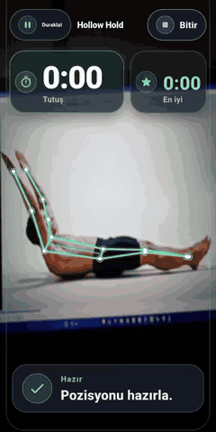
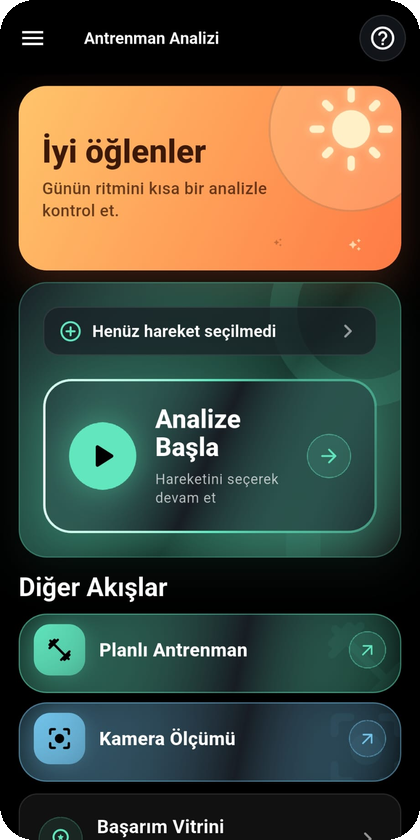
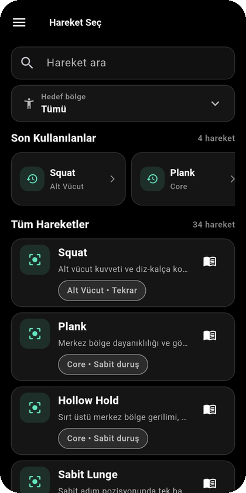
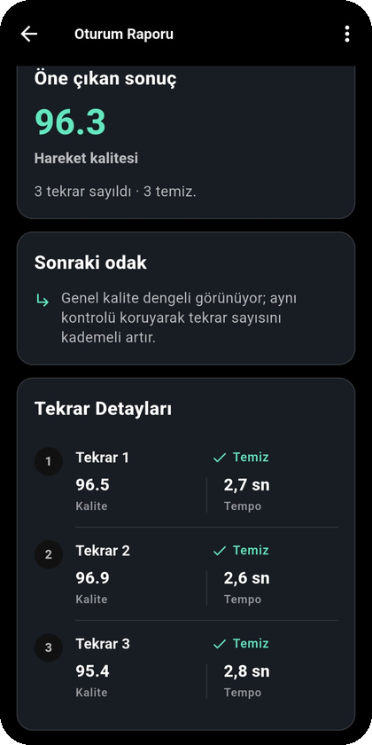
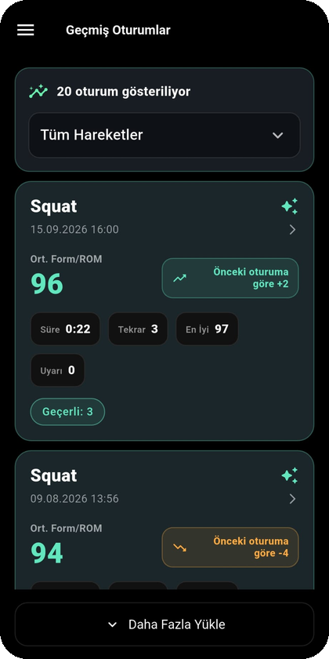
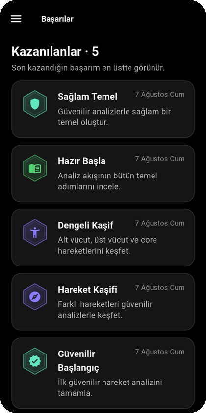
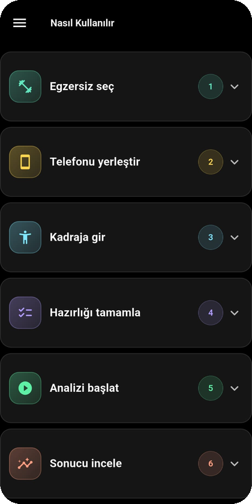
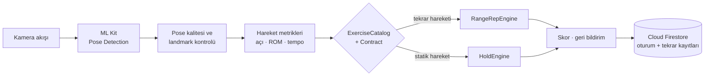

<div align="center">



<br/>

[](https://github.com/bkrbzdgn40/pea/actions/workflows/flutter-ci.yml)


**Telefonunun kamerası, kişisel hareket analistin olsun.**

PEA; kamera görüntüsünden vücut eklemlerini gerçek zamanlı çıkarır, hareketini cihaz üzerinde analiz eder, tekrarlarını sayar, formunu puanlar ve her oturumu geçmişinde saklar.

<sub>🇬🇧 <b>TL;DR:</b> PEA is a Flutter app that runs on-device pose estimation (Google ML Kit) on the camera stream and turns it into rep counting, hold timing, form scoring and per-session history for 34 exercises. Firebase handles auth and storage. Everything is explicit about what it measures, and never fabricates data.</sub>

</div>

---

## 🎬 Çalışırken

<div align="center">
<table>
  <tr>
    <td align="center"></td>
    <td align="center"></td>
  </tr>
  <tr>
    <td align="center"><b>Squat</b> · tekrar sayımı, form skoru, anlık geri bildirim</td>
    <td align="center"><b>Hollow Hold</b> · statik tutuş süresi ve form takibi</td>
  </tr>
</table>
</div>

> Demo kayıtları, ekranda oynatılan egzersiz videolarının telefon kamerasına gösterilmesiyle alınmıştır. Videolardan biri [Pexels](https://www.pexels.com/license/) lisanslı bir stok videodur, diğeri Google Flow ile üretilmiş yapay zekâ videosudur. Amaç analiz akışını görsel olarak göstermektir; gerçek kullanıcı testi veya cihaz kabul kanıtı yerine geçmez (bkz. [Doğrulama](#-doğrulama-ve-güvenilirlik)).

## ✨ Öne çıkanlar

- **Cihaz üstü analiz:** ML Kit Pose Detection ile kamera akışından eklem noktaları çıkarılır; analiz telefonda çalışır.
- **34 hareket:** Squat'tan Plank'e, Push-up'tan Y Raise'e kadar 30 tekrar tabanlı ve 4 statik tutuş hareketi analiz kataloğunda aktiftir.
- **İki analiz motoru ailesi:** Tekrar hareketleri için `rangeRep`, statik hareketler için `hold` motoru; her hareket kendi sözleşmesi (contract) ve eşikleriyle çalışır.
- **Form skoru ve canlı geri bildirim:** Tekrar kalitesi, tempo ve ölçüm güveni anlık gösterilir.
- **Oturum raporu ve geçmiş:** Her tekrarın kalite ve temposu kaydedilir; önceki oturumla karşılaştırma yapılır.
- **Başarımlar ve hedefler:** Güvenilir analiz verisine bağlı ödül ve hedef yüzeyleri.
- **"Sahte veri yok" ilkesi:** Veri yoksa 0 gösterilmez, tahmini skor üretilmez. Farklı hareketlerin skorları tek bir uydurma metrikte birleştirilmez.

## 📱 Ekranlar

<div align="center">
<table>
  <tr>
    <td align="center"><br/><sub><b>Ana sayfa</b></sub></td>
    <td align="center"><br/><sub><b>Hareket seçimi</b> (34 hareket)</sub></td>
    <td align="center"><br/><sub><b>Oturum raporu</b></sub></td>
  </tr>
  <tr>
    <td align="center"><br/><sub><b>Geçmiş oturumlar</b></sub></td>
    <td align="center"><br/><sub><b>Başarılar</b></sub></td>
    <td align="center"><br/><sub><b>Nasıl kullanılır</b></sub></td>
  </tr>
</table>
</div>

## ⚙️ Nasıl çalışır?



**`rangeRep`** hareketleri şu faz akışıyla izler: `neutral → descending → peak → ascending → neutral`. Bir tekrarın sayılması için poz, faz sırası ve hareket aralığı koşulları sağlanmalıdır.

**`hold`** hareketleri `ready → holding → broken` akışını izler; görünürlük kaybı geçerli süreye eklenmez, form bozulması ayrıca kaydedilir.

Her hareketin hangi motorla, hangi sinyallerle ve hangi eşiklerle çalışacağı `ExerciseCatalog` ve `assets/config/exercises/*.json` dosyalarında tanımlıdır. Yeni hareket eklemek için bkz. [`docs/development/adding-exercises.md`](./docs/development/adding-exercises.md).

<details>
<summary><b>34 hareketin tamamı</b></summary>

**Statik tutuş (`hold`) – 4:** Plank, Hollow Hold, Wall Sit, Side Plank

**Tekrar tabanlı (`rangeRep`) – 30:** Squat, Stationary Lunge, Push-up, Sit-up, Crunch, Reverse Crunch, Biceps Curl, Lying Leg Raise, Bent-Knee Leg Raise, Standing Hamstring Curl, Standing Hip Abduction, Bench Dip, Romanian Deadlift, Good Morning, Lateral Raise, Shoulder Press, Overhead Triceps Extension, Upright Row, Calf Raise, Front Raise, Glute Bridge, Jumping Jack, Standing Hip Extension, Standing Knee Raise, Standing Straight-Leg Raise, V-Up, Frog Pump, Lying Triceps Extension, Floor Chest Press, Y Raise

Güncel hareket bazlı durum için: [`docs/current_exercise_validation_matrix.md`](./docs/current_exercise_validation_matrix.md)

</details>

## 🧱 Mimari ve teknoloji

| Katman | Teknoloji |
| --- | --- |
| Arayüz | Flutter, Dart, koyu tema, `fl_chart` |
| Durum yönetimi | Riverpod |
| Bilgisayarlı görü | Google ML Kit Pose Detection, `camera` |
| Kimlik doğrulama | Firebase Authentication |
| Veri | Cloud Firestore (+ güvenlik kuralları ve kural testleri) |
| Sunucu tarafı | Firebase Cloud Functions (TypeScript) |
| Kalite | GitHub Actions: format, analyze, test, coverage |

Proje feature-bazlı ve katmanlı ilerler; analiz mantığı arayüz katmanından ayrıdır:

```text
lib/
├── app/                    # uygulama kabuğu, tema, navigasyon, yerelleştirme
├── core/                   # ortak altyapı
└── features/
    ├── auth/
    ├── workout_analysis/   # application · domain · infrastructure · presentation
    ├── goals/
    ├── achievements/
    ├── rewards/
    └── challenges/
```

**Veri modeli:** Oturumlar kullanıcı bazlı saklanır; tekrar düzeyindeki kayıtlar ayrı alt koleksiyondadır.

```text
users/{uid}/sessions/{sessionId}
users/{uid}/sessions/{sessionId}/reps/{repId}
```

## ✅ Doğrulama ve güvenilirlik

| | |
| --- | --- |
| **Otomatik test** | `test/` altında 296 test dosyası, `functions/test` altında ek testler |
| **Firestore kuralları** | Kurallar ayrıca test edilir (`test/firestore_rules_test.dart`) |
| **CI** | Her PR ve `main` push'unda: `dart format` kontrolü, `flutter analyze`, `flutter test`, coverage raporu; Functions için ayrı build+test işi |
| **Android profile build** | `main` üzerinde elle tetiklenen workflow ile profile APK ve commit SHA metadata'sı üretilir |

Desteğin dürüst ifadesi önemlidir; bu proje dört şeyi birbirinden ayırır:

| Katman | Anlamı | Anlamına gelmediği |
| --- | --- | --- |
| Rehber içeriği | Hareket için açıklama ve rehber vardır | Canlı analizin aktif olduğu |
| Catalog desteği | Hareket canlı analiz katalogunda aktiftir | Her cihazda biyomekanik olarak kabul edildiği |
| Otomatik doğrulama | Test ve CI kod yolunu doğrular | Gerçek cihaz kabulü |
| Cihaz doğrulaması | Belirli build/cihaz/senaryoda ölçüm kanıtı | Diğer cihazların otomatik doğrulandığı |

Hareketler geliştirici tarafından kendi cihazında tek tek denenmiştir. **Çoklu cihaz formal kabulü henüz yapılmamıştır**; bu, açık bir sınırlama olarak yol haritasındadır.

## 🚀 Kurulum

**Gereksinimler:** Flutter (stable, Dart `^3.11`), kameralı bir Android/iOS cihaz veya emülatör, kendi Firebase projen.

```bash
git clone https://github.com/bkrbzdgn40/pea.git
cd pea
flutter pub get

# Kendi Firebase projenle çalışmak için:
flutterfire configure   # firebase_options.dart ve platform yapılandırmasını üretir

flutter run
```

Kalite kontrolleri (CI ile aynı):

```bash
dart format --set-exit-if-changed .
flutter analyze
flutter test
```

## 🗺️ Yol haritası

| Öncelik | Başlık |
| --- | --- |
| Yüksek | Tekrarlanabilir cihaz kabul matrisi: build SHA, cihaz, OS, kamera yönü ve senaryo metadata'sıyla Low/Mid/High cihaz çeşitliliği |
| Yüksek | Yeni hareketleri yalnız engine uyumu, test ve cihaz kanıtı tamamlandığında aktif etmek |
| Orta | Egzersiz bazlı form skorunun nedenini daha anlaşılır göstermek |
| Orta | Sesli geri bildirim |
| Orta | Hold ailesi genellemesini kanıtla güçlendirmek |
| Orta | Test kapsamını artırmak |

## 📚 Dokümantasyon

| Belge | İçerik |
| --- | --- |
| [`docs/current_exercise_validation_matrix.md`](./docs/current_exercise_validation_matrix.md) | Hareket bazlı güncel çalışma ve doğrulama durumu |
| [`docs/feature_status_matrix.md`](./docs/feature_status_matrix.md) | Her ürün yüzeyinin gerçek / yerel / demo durumu |
| [`docs/development/adding-exercises.md`](./docs/development/adding-exercises.md) | Yeni hareket ekleme rehberi |
| [`docs/beta/`](./docs/beta) | Tarihsel beta doğrulama kayıtları |
| [`docs/rewards/`](./docs/rewards) | Ödül, başarım ve ilerleme kayıt tasarımı |

## ℹ️ Proje durumu

PEA aktif geliştirme altındadır ve henüz mağazada yayınlanmamıştır. Uygulama içindeki AI Coach yüzeyi şimdilik demo/"yakında" durumundadır. Lisans bilgisi henüz eklenmemiştir.

---

<div align="center">

**PEA, kullanıcıya yalnızca gerçekten ölçtüğünü gösterir ve kapsamını kanıtla genişletir.**

</div>
